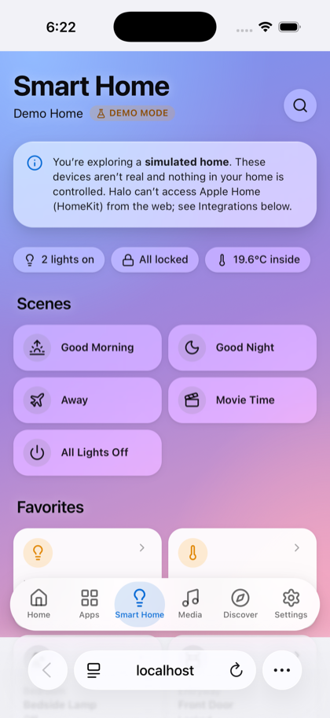
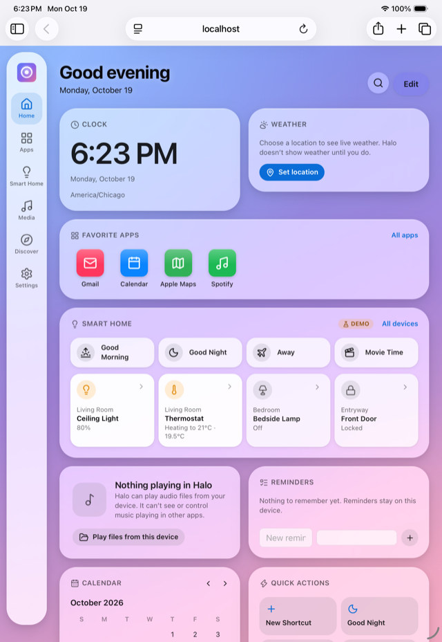
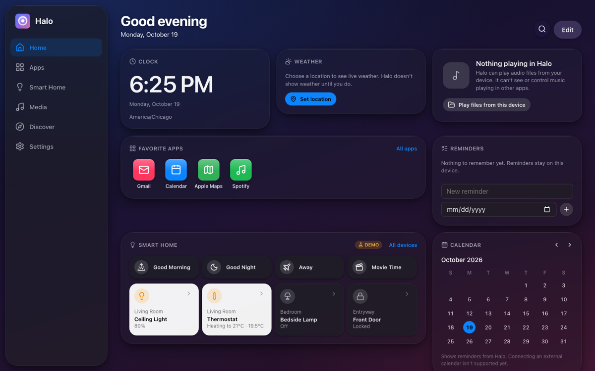

# Halo

**Your digital world, beautifully unified.**

Halo is a Liquid Glass–inspired home hub for iPhone, iPad and desktop. It runs in
the browser and installs as a Progressive Web App (PWA), bringing your app
shortcuts, smart-home controls, media, widgets and search into one place.

<p>
  
  
</p>


<sub>iPhone and iPad screenshots are from Mobile Safari in the iOS 26.1 Simulator.</sub>

> Halo is an independent personal project. It isn't an Apple product, isn't
> affiliated with or endorsed by Apple, doesn't replace the iOS Home Screen and
> uses no private iOS APIs. "Halo" is a provisional name pending availability
> and trademark checks.

## Features

| Section | What it does |
| --- | --- |
| **Home** | Greeting, date and a customizable widget dashboard: clock, live weather, favorite apps, smart-home scenes and pinned devices, Now Playing, reminders, month calendar, notes, quick actions and optional Hacker News. Edit mode adds, removes, reorders and resizes widgets. |
| **Apps** | A home-screen-style launcher for websites, Universal Links, `mailto:`/`tel:` links and app URL schemes, with folders, favorites, search, filters, recents, edit/reorder mode and website/App Store fallbacks. |
| **Smart Home** | A fully interactive, clearly labelled **demo home**: rooms, dimmable lights, plugs, a thermostat with a running simulation, a lock, sensors, a camera and five scenes. |
| **Media** | Curated music, video and podcast destinations, plus a real player for audio files on your device with lock-screen controls via the Media Session API. |
| **Discover** | 26 hand-picked apps with official App Store links, live details (icons, screenshots, ratings) from Apple's public Search API, App Store search and "Add to Apps". |
| **Search** | ⌘K, `/` or the search button on any page searches shortcuts, devices, rooms, scenes, media, widgets, Discover and settings. |
| **Settings** | Light/dark/automatic theme, accent color, gradient or photo wallpaper, glass intensity, accessibility options, units, backup export/import, reset, install help and a privacy summary. |

It also works offline after the first visit, updates only when you choose to, and
meets WCAG 2.1 AA contrast in light and dark mode (checked automatically with axe).

### What Halo deliberately doesn't do

A web app can't list installed iOS apps, confirm that a native app opened, use
HomeKit, WidgetKit, Siri or App Intents, read playback from other apps, run in the
background or draw over other apps. Halo never pretends otherwise:

- App URL schemes may fail silently, so Halo watches whether the page lost focus
  and, if it can't confirm the app opened, says so and offers the website or
  App Store link.
- Smart-home devices are simulated and labelled **Demo** everywhere.
- Now Playing reports only Halo's own player.
- Weather appears only after you choose a location. There is no placeholder forecast.

## Getting started

Requires **Node.js 22.12 or later** and npm.

```sh
npm install
npm run dev          # dev server at http://localhost:5173
npm run check        # typecheck, lint, unit tests and production build
npm run preview      # serve the production build at http://localhost:4173
```

| Script | Purpose |
| --- | --- |
| `dev` | Vite dev server with hot reload (the service worker is disabled in dev) |
| `build` | Type-check and build to `dist/` |
| `typecheck` | `tsc -b` across app, tooling and e2e configs |
| `lint` | oxlint (including React hooks and React Compiler rules) |
| `test` / `test:watch` | Vitest unit and component tests |
| `test:e2e` | Playwright against the production build (see below) |
| `check` | Everything CI's first job runs, in order |
| `icons` | Regenerate PNG icons from the SVGs in `public/icons/` |

### Testing

- **Unit and component tests** (Vitest, Testing Library, jsdom): stores and
  validation, URL safety, backup import/export, smart-home logic, weather and App
  Store parsing, search ranking, the audio player, and user flows for every
  section.
- **End-to-end tests** (Playwright) run against `vite preview` in **iPhone
  WebKit**, **iPad WebKit** and **desktop Chromium**: navigation and deep links,
  responsive layout, persistence across reloads, offline use, the manifest,
  axe-core accessibility scans of every page in light and dark mode, focus
  management, and older-browser fallbacks.

```sh
npx playwright install chromium webkit   # first time only
npm run test:e2e
```

## Architecture

```
src/
  app/            Shell, routes, navigation, theme controller
  components/     Reusable UI: GlassCard, Button, Sheet, Toggle, Slider, fields…
  design-system/  Tokens, glass surfaces, base styles, theme logic and store
  features/       One folder per section: home, apps, smart-home, media,
                  discover, search, settings
  integrations/   smart-home: the SmartHomeProvider contract and demo provider
  services/       Weather, App Store, news, audio player, app hand-off detection
  storage/        Versioned persisted stores, backups, IndexedDB wrapper
  pwa/            Service-worker template, registration, install state
  hooks/, utils/  Shared hooks, guards, URL and formatting helpers
tests/
  unit/           App-level component tests
  e2e/            Playwright specs
scripts/          Icon generation and the service-worker build plugin
```

- **State** lives in small persisted stores (`storage/persistedStore.ts`) built
  on `useSyncExternalStore`. Each store has a key, a schema version, a validator
  and an optional migration, and syncs across tabs. Corrupt or newer-version data
  falls back to defaults instead of crashing. `storage/allStores.ts` registers
  every store so backup, import and reset cover all data.
- **Integrations** sit behind interfaces with injected dependencies (e.g.
  `SmartHomeProvider`, and a `fetch` parameter on every service), so they can be
  tested without a network and replaced later.
- **Styling** is plain CSS: design tokens and global glass classes in
  `design-system/`, and a CSS Module per component. Theme, accent, glass
  intensity and accessibility options are attributes and custom properties on
  `<html>`, set before first paint.
- **Routing** uses React Router with the Vite base path as basename. Filters and
  open items (`?q=`, `?filter=`, `?room=`, `?device=`, `?app=`, `#section`) live
  in the URL so Back/Forward and links work.

## Deployment (GitHub Pages, free)

The repository includes two workflows:

- `.github/workflows/ci.yml` runs `npm run check` and the Playwright suite on
  pushes and pull requests.
- `.github/workflows/deploy.yml` builds and deploys `dist/` to GitHub Pages on
  every push to `main`.

To deploy:

1. Push the repository to GitHub.
2. In **Settings → Pages**, set **Source** to **GitHub Actions**.
3. Push to `main`, or run the workflow manually. The site is published at
   `https://<user>.github.io/<repo>/`.

The base path is derived from the repository name, so the repo doesn't need to
be called `halo`. A `<user>.github.io` repository deploys to `/`. For a custom
domain or other path, set a repository variable `HALO_BASE` (for example `/`).
To build for a path locally: `HALO_BASE=/my-repo/ npm run build`.

GitHub Pages has no SPA rewrites, so the build also writes `404.html` (a copy of
the app shell). Deep links such as `/<repo>/smart-home` therefore load Halo,
although the first response has HTTP status 404. Pages serves HTTPS, which the
service worker requires.

Any static host with HTTPS works the same way: serve `dist/` and fall back to
`index.html` for unknown paths.

## Installing on iPhone and iPad

1. Open Halo in Safari.
2. Tap **Share** (on iOS 26 it may be under the **•••** menu).
3. Choose **Add to Home Screen**, then **Add**.

Halo then opens in its own standalone window. Installing doesn't grant extra
permissions. Settings → Install Halo shows these steps, plus an install button
in browsers that support one.

## Updates and offline use

The service worker precaches the app shell and build assets (never API
responses). When a new version is deployed, Halo shows **"A new version of Halo
is ready"** with a **Reload** button. It never reloads on its own, and installed
apps check for updates whenever they're reopened. Old caches are deleted
automatically.

## Compatibility

Halo targets **Safari 14+ (iOS/iPadOS 14+)** and current Chrome, Edge and
Firefox. It is tested in Mobile Safari on iOS 26.1 (Simulator), Playwright
WebKit and Chromium. Older browsers get a clear notice instead of a blank page.
See **[docs/COMPATIBILITY.md](docs/COMPATIBILITY.md)** for the full matrix,
including what was actually tested.

## Privacy

- No accounts, analytics, tracking or backend. Halo never asks for or stores
  passwords.
- Everything (settings, shortcuts, layout, reminders, notes, demo state) stays
  in your browser's storage on this device. Export a backup from Settings to
  move it.
- Halo contacts only these services, and only when you use the related feature:

| Service | When | What it receives |
| --- | --- | --- |
| Open-Meteo (weather and geocoding) | After you set a weather location | A city search term, or coordinates rounded to ~100 m |
| Apple iTunes Search API | Opening a Discover listing or searching the App Store | An app ID or search term, and your region |
| Apple image CDN | Discover shows icons or screenshots | Standard image requests, no referrer |
| Hacker News API | Only if you add the Hacker News widget | Nothing personal |

Details and setup notes for optional integrations are in
**[docs/INTEGRATIONS.md](docs/INTEGRATIONS.md)**.

## Known limitations

- Smart Home is a demo; no real integration ships yet (see the bridge design in
  `docs/INTEGRATIONS.md`).
- The calendar shows Halo's reminders only; connecting iCloud or Google
  calendars would need OAuth and a backend.
- App URL schemes can't be verified in advance; Halo can only report when it
  can't confirm an app opened.
- Custom photo wallpapers aren't included in backups.
- Installed-app behaviour (standalone window, Add to Home Screen) follows each
  browser; it wasn't automated on a physical device.
- Support for iOS 10–13 is limited to an "update your browser" notice; see the
  compatibility doc for why.

## Roadmap

- [x] Design system, Liquid Glass surfaces with fallbacks, light/dark themes
- [x] App shell with phone, tablet and desktop layouts
- [x] Versioned storage, backup export/import, reset
- [x] Apps launcher with folders, favorites and safe app-link hand-off
- [x] Home dashboard with live weather and customizable widgets
- [x] Smart Home demo behind a provider interface
- [x] Media destinations and a local Now Playing player
- [x] Discover with curated picks and App Store links
- [x] Unified search
- [x] Settings and personalization
- [x] PWA: manifest, icons, offline support, update prompt
- [x] Unit, e2e and accessibility tests; CI and Pages deployment
- [ ] Self-hosted smart-home bridge (Home Assistant) behind `SmartHomeProvider`
- [ ] Calendar import from `.ics` files
- [ ] Drag-to-reorder on touch, in addition to the move buttons
- [ ] Testing on physical iPhone/iPad hardware and older iOS simulator runtimes
- [ ] Optional native companion app for HomeKit and widgets (needs the Apple Developer Program)

## License

No license has been chosen yet. Until one is added, all rights are reserved.
