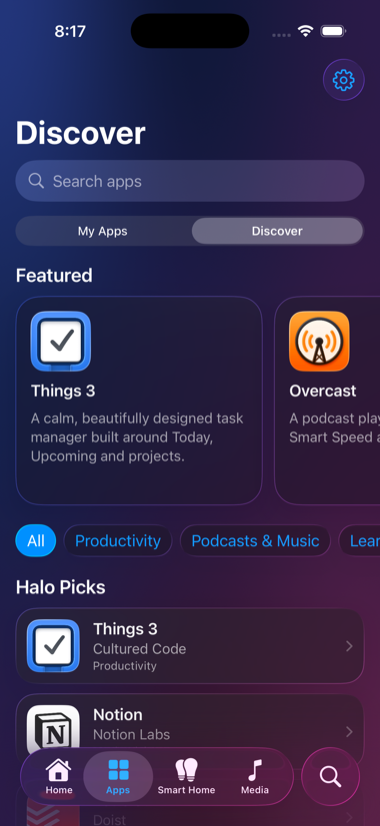

# Halo

**Your digital world, beautifully unified.**

Halo is a native iPhone and iPad app that brings your Apple Home, Apple apps,
Apple Music, calendar and reminders, and App Store discovery together in one
**Liquid Glass** interface, built with SwiftUI for iOS 26.

<p>
  
  
</p>


<sub>Screenshots from the iOS 26.1 Simulator. The Smart Home section is showing the built-in demo home.</sub>

> Halo is an independent project. It isn't affiliated with or endorsed by
> Apple, and it can't replace the iOS Home Screen. "Halo" is a provisional name.

## Features

| Section | What it does | Apple framework |
| --- | --- | --- |
| **Home** | Greeting and a customizable dashboard: clock, weather, upcoming events, reminders (complete and add them), pinned devices and scenes, favorite apps, Now Playing, quick actions, notes. Show, hide, reorder and resize widgets; wide widgets span both columns on iPad. | EventKit, MapKit, CoreLocation |
| **Apps** | Starts with 14 of Apple's own apps (Music, Maps, Calendar, Shortcuts…) and **automatically mirrors popular apps installed on your device** (Spotify, WhatsApp, Instagram, YouTube and 31 more), all with their real App Store icons. Detected apps disappear when you delete them. Opens apps, and offers the App Store page when one isn't installed. Add your own website and app-link shortcuts, favorite them, sort them into folders, search and rearrange. | UIKit `canOpenURL`/`open`, StoreKit |
| **Discover** (in Apps) | 26 hand-picked apps with real icons, screenshots and ratings from Apple, App Store search, favorites and history. "View in App Store" opens the real App Store page inside Halo. | StoreKit, iTunes Search API |
| **Smart Home** | Your **Apple Home**: rooms, lights with dimming, outlets and switches, thermostats, locks, sensors, cameras and scenes, kept live. Plus a clearly labeled **demo home** for exploring without accessories. | HomeKit |
| **Media** | What's playing in the **Music app**, with artwork, progress and play/pause/skip. Shortcuts to Music, Podcasts, TV and Books. | MediaPlayer |
| **Search** | The floating Liquid Glass search button finds apps, devices, rooms, scenes, Discover picks, widgets and settings, and acts on them in place. | SwiftUI search tab |
| **Settings** | Theme, accent, wallpaper, units, Smart Home source, backup export/import, reset, and a privacy summary with live permission status. | SwiftUI file export/import |

The interface uses the system **Liquid Glass** throughout: the tab bar (a
sidebar on iPad), the detached search button, toolbars, buttons, chips and
cards, over mesh-gradient wallpapers.

### Honest limits

- Halo only sees the **Music app's** playback, not other apps'.
- iOS doesn't let any app list everything installed or read other apps' icons.
  Halo checks for Apple's apps plus 35 popular ones (iOS caps these checks at 50
  URL schemes) and uses each app's App Store icon. Add other apps from Discover.
- It doesn't install apps; installs happen in the App Store.
- Smart Home needs Apple Home to be set up in Apple's Home app (or use the demo).

## Requirements

- A Mac with **Xcode 26** or later (iOS 26 SDK)
- An iPhone or iPad on **iOS/iPadOS 26**, or the Simulator
- An Apple ID. A free one works for running on your own devices (see below).

## Run it

### In the Simulator

```sh
open Halo.xcodeproj
```

Choose an iPhone or iPad simulator and press **Run** (⌘R). No signing setup is
needed for the Simulator.

### On your iPhone or iPad with a free Apple ID

1. In Xcode, select the **Halo** target → **Signing & Capabilities**.
2. Under **Team**, choose your **Personal Team** (add your Apple ID in Xcode →
   Settings → Accounts if it isn't listed).
3. Change the **Bundle Identifier** to something unique, e.g.
   `com.yourname.halo`.
4. Connect your device, turn on **Developer Mode** (Settings → Privacy &
   Security) when iOS asks, choose the device in Xcode and press **Run**.
5. The first time, trust your developer certificate in Settings → General →
   VPN & Device Management.

Free provisioning has limits: **apps stop launching after 7 days** (run from
Xcode again to reinstall), only a few apps can be installed this way per
device, and some capabilities aren't available to personal teams. If Xcode
says your team can't use a capability (for example HomeKit), remove it in
Signing & Capabilities. Halo then uses the demo home.

### What the paid Apple Developer Program would add

Publishing on the App Store or TestFlight, installs that don't expire,
**WeatherKit** (Apple weather to replace Open-Meteo), and capabilities free
teams can't use, such as App Groups for Home Screen widgets.

### Testing HomeKit without accessories

Apple's **HomeKit Accessory Simulator** (in *Additional Tools for Xcode*,
downloadable from developer.apple.com with your Apple ID) creates virtual
accessories that appear in the Simulator's Home data.

## Project structure

```
Halo/
  App/            App entry, AppModel (owns all stores), tab shell, launch options
  DesignSystem/   Wallpapers (MeshGradient), GlassCard, SectionScreen
  Features/       Home, Apps, Discover, SmartHome, Media, Search, Settings
  Services/       HomeKit + demo providers, launcher, app opener, App Store,
                  Music, Calendar/Reminders, Weather, dashboard
  Storage/        Versioned JSON stores, backup format
HaloTests/        Unit tests (Swift Testing)
HaloUITests/      UI tests (XCTest)
Design/           Icon artwork (SVG sources)
project.yml       XcodeGen spec for Halo.xcodeproj
```

- **State** lives in small `@Observable` stores saved as versioned JSON in
  Application Support. Corrupt or newer-format files fall back to defaults.
- **Smart Home** goes through a `SmartHomeProvider` protocol; `HomeKitProvider`
  and `DemoHomeProvider` implement it. HomeKit-to-Halo mapping is a pure,
  unit-tested function.
- **Concurrency:** Swift 6 strict concurrency. Callbacks from EventKit and
  MediaPlayer, which arrive on background queues, are `@Sendable` and convert
  to value types immediately.
- The Xcode project is generated from `project.yml`. After changing targets or
  settings, run `xcodegen generate` (install with `brew install xcodegen`) and
  commit both files; CI checks they match.

## Tests

```sh
xcodebuild test -project Halo.xcodeproj -scheme Halo \
  -destination 'platform=iOS Simulator,name=iPhone 17 Pro'
```

- **Unit tests** cover storage, URL validation, the launcher, App Store
  parsing and error handling, HomeKit mapping, the demo home, search ranking,
  dashboard layout, weather parsing, reminder sorting and backups.
- **UI tests** drive real flows in the Simulator, including the actual system
  permission prompts: granting HomeKit, Apple Music and Reminders access,
  creating and completing a real reminder, opening Apple Maps from the
  launcher, the App Store offer for an app that isn't installed, Discover, the
  demo home, search, Customize Home and Settings.

GitHub Actions runs both on every push and pull request (`.github/workflows/ios.yml`).

### Performance benchmarks

Debug builds include a frame monitor and self-driving benchmarks that run
without XCTest (whose accessibility queries slow the app down while
measuring). Launch with `-haloBenchScroll` (plus `-haloSection apps`, `home` or
`smartHome`) to scroll a section up and down, or `-haloBenchTabs` to switch
tabs. Results print to the console as late-frame counts, e.g.:

```sh
xcrun simctl launch --console-pty booted io.github.av1452.halo -haloSection apps -haloDemoHome -haloBenchScroll
# BENCH scroll: frames=478 hitches=3 hitchMs=67 worstMs=50
```

The Simulator draws Liquid Glass on the Mac's CPU, so treat its numbers as
before/after comparisons; a device is smoother.

### Verified vs. not yet verified

Verified in the iOS 26.1 Simulator on iPhone 17 Pro and iPad Pro 11-inch:
everything listed under UI tests, plus Liquid Glass rendering in light and
dark mode.

**Not yet verified on a physical device:** controlling real HomeKit
accessories (the Simulator has no home set up), live Apple Music playback (the
Simulator has no Music app), and StoreKit's in-app App Store sheet (the
Simulator falls back to opening the App Store link).

## Privacy

No accounts, analytics or tracking. Halo stores its own data on the device.
It reads Apple Home, Calendar, Reminders and Music data only with your
permission, and never copies it into backups. Halo makes network requests only
for these features:

| Service | When | What it receives |
| --- | --- | --- |
| Apple iTunes Search API and Apple's image servers | Showing app icons, browsing or searching Discover | App IDs or your search term, and your region |
| Websites you add as shortcuts | Once, to fetch the site's own icon | A standard request for its `apple-touch-icon` |
| Open-Meteo | After you choose a weather location | Coordinates rounded to about 1 km |

Icons are cached on the device after the first download.

## The web version

Halo started as a Progressive Web App. That version is preserved at the
[`web-v0.1.0`](https://github.com/av1452/halo/tree/web-v0.1.0) tag.

## Roadmap

- [ ] Verify HomeKit control, Apple Music and StoreKit on a physical device
- [ ] WeatherKit, once in the Apple Developer Program
- [ ] Home Screen widgets and Control Center controls (WidgetKit), which need App Groups
- [ ] Siri and Shortcuts actions (App Intents)
- [ ] Apple Watch companion

## License

[MIT](LICENSE)
